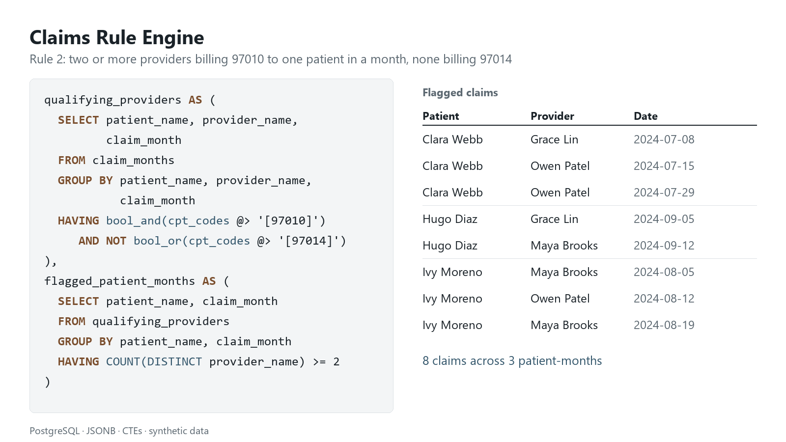

# Claims Rule Engine in SQL

Three claims-audit business rules, written as PostgreSQL queries over medical claims whose CPT codes are stored as JSONB arrays.

The task: given claims data and a set of written business rules, return every claim (patient, provider, date) that each rule flags. The rules look for billing patterns worth a second look: a specialist leaving out a code for a frequent patient, several providers billing the same treatment in one month, and a provider skipping a code they normally bill.



## Data model

| Table | Grain | Columns |
|---|---|---|
| `providers` | one row per provider | `provider_name` (PK), `specialty` |
| `claims_raw` | claims as exported | `patient_name`, `provider_name`, `from_date_range`, `cpt_codes` as text, e.g. `{97110,97140}` |
| `claims` | one row per claim | `claim_id`, `patient_name`, `provider_name`, `from_date_range`, `cpt_codes` as a JSONB array |

A claim is identified by patient, provider and date. The export stores CPT codes as text (`{97110,97140}`), so the load step converts them to JSONB arrays with a small function, `cpt_text_to_jsonb`. That makes "does this claim include code X" a single `@>` test that a GIN index supports, and every new file is ready for the rules without manual fixes.

## The rules

| CPT code | Meaning |
|---|---|
| 97010 | Hot or cold packs |
| 97014 | Electrical stimulation |
| 97110 | Therapeutic exercise |
| 97140 | Manual therapy |

**Rule 1: Specialist code omission for frequent patients** ([sql](sql/rule_1_frequent_patient_code_omission.sql))
Flag an Occupational Therapy or Chiropractic claim that does not include 97140, when the patient has more than 5 claims in total with any provider.
A CTE counts each patient's claims across all providers. The main query joins it to the claims of the two specialties and keeps those without 97140. Claims are counted as distinct (provider, date) pairs, so the count stays right even if a source file splits one claim over several rows.

**Rule 2: Multi-provider overlap within a month** ([sql](sql/rule_2_multi_provider_overlap.sql))
Flag claims when, in one calendar month, at least 2 different providers billed the same patient, and every claim from each of those providers that month includes 97010 while none includes 97014.
Three CTEs, each one step of the rule:
1. `claim_months` tags each claim with its calendar month.
2. `qualifying_providers` groups by patient, provider and month and keeps the groups where `bool_and(has 97010)` is true and `bool_or(has 97014)` is false.
3. `flagged_patient_months` keeps patient-months with 2 or more qualifying providers.

The final join returns the claims behind each flag. Claims from other providers that month who did not meet the conditions are left out, so reviewers see only the claims that caused the flag.

**Rule 3: Provider-specific code deviation in Physical Therapy** ([sql](sql/rule_3_provider_code_deviation.sql))
Flag a Physical Therapy claim that has 97010 but not 97110, when the same provider billed 97110 on any other claim.
A correlated `EXISTS` subquery checks the provider's other claims for 97110. Any claim with 97110 is necessarily a different claim from the flagged one, so no date filter is needed. A same-day 97110 claim for another patient still counts.

## Results on the sample data

The sample data in [`data/`](data/) is synthetic: 29 claims, 6 invented patients and 6 invented providers. It was built so each rule has cases that should trigger and near-misses that should not.

**Rule 1**: 3 claims

| patient_name | provider_name | from_date_range |
|---|---|---|
| Hugo Diaz | Ruth Okafor | 2024-08-23 |
| Nora Ellis | Daniel Reyes | 2024-07-09 |
| Nora Ellis | Ruth Okafor | 2024-07-16 |

Felix Grant also has a Chiropractic claim without 97140, but only 4 claims in total, so it does not trigger.

**Rule 2**: 8 claims across 3 patient-months

| patient_name | provider_name | from_date_range |
|---|---|---|
| Clara Webb | Grace Lin | 2024-07-08 |
| Clara Webb | Owen Patel | 2024-07-15 |
| Clara Webb | Owen Patel | 2024-07-29 |
| Hugo Diaz | Grace Lin | 2024-09-05 |
| Hugo Diaz | Maya Brooks | 2024-09-12 |
| Ivy Moreno | Maya Brooks | 2024-08-05 |
| Ivy Moreno | Owen Patel | 2024-08-12 |
| Ivy Moreno | Maya Brooks | 2024-08-19 |

These rows show the edge cases:
- Ivy Moreno's August claim from Grace Lin includes 97014, so Grace Lin does not qualify, and that claim is not returned.
- Clara Webb's July claim from an Occupational Therapist has no 97010, so it is not returned either.
- Leo Hart in September does not trigger: one provider billed 97014, and the other did not use 97010 on every claim.

**Rule 3**: 6 claims

| patient_name | provider_name | from_date_range |
|---|---|---|
| Clara Webb | Owen Patel | 2024-07-29 |
| Felix Grant | Iris Novak | 2024-09-12 |
| Hugo Diaz | Maya Brooks | 2024-09-12 |
| Ivy Moreno | Owen Patel | 2024-08-12 |
| Ivy Moreno | Maya Brooks | 2024-08-19 |
| Nora Ellis | Owen Patel | 2024-09-03 |

Iris Novak's only 97110 claim falls on the same day as the flagged claim, for another patient, and the rule still catches it. Grace Lin's 97010 claims are not flagged because she never bills 97110.

The same results are in [`results/`](results/) as CSV.

## Run it

```bash
createdb claims_demo
psql -d claims_demo -f run_all.sql
```

Run from the repository folder. `run_all.sql` builds the schema, loads the sample data and prints each rule's result. Requires PostgreSQL 13 or later.

## Repository layout

```
sql/01_schema.sql                               tables, GIN index, text-to-JSONB function
sql/02_sample_data.sql                          synthetic data, loaded through claims_raw
sql/rule_1_frequent_patient_code_omission.sql
sql/rule_2_multi_provider_overlap.sql
sql/rule_3_provider_code_deviation.sql
run_all.sql                                     runs everything in order
data/                                           the sample data as CSV
results/                                        each rule's output as CSV
```

## Skills shown

CTEs, `GROUP BY` with `HAVING`, `bool_and` and `bool_or` aggregates, correlated `EXISTS` subqueries, JSONB containment (`@>`) with a GIN index, and turning written business rules into testable queries.

All data in this repository is synthetic.
